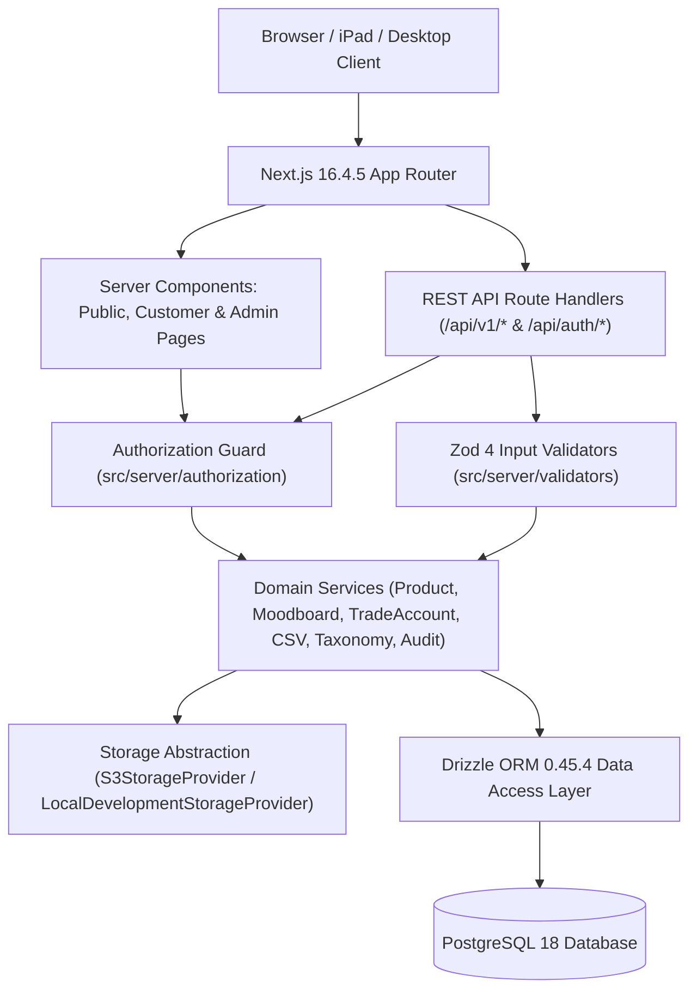

# System Architecture — MaterialHub

**Architecture Style:** Modular Monolith (Next.js App Router + Service Layer + Drizzle DAL + PostgreSQL)

---

## 1. High-Level Architecture Diagram

---

## 2. Layered Responsibilities

| Layer | Location | Responsibility |
|---|---|---|
| Presentation Layer | `src/app/`, `src/components/` | Editorial UI rendering, URL state synchronization, accessible forms, responsive desktop/iPad/mobile layouts. |
| API & Route Layer | `src/app/api/v1/` | HTTP request parsing, rate limiting, standardized JSON envelope formatting (`{ success, data, meta }` / `{ success, error }`). |
| Authorization Layer | `src/server/authorization/index.ts` | Centralized server-side session resolution via Better Auth, role checks (`MEMBER` vs `ADMIN`), trade status checks (`APPROVED`), and moodboard ownership verification. |
| Validation Layer | `src/server/validators/index.ts` | Strict Zod 4 schemas for products, SKUs, slugs, pagination parameters, moodboards, trade account transitions, and CSV rows. |
| Service Layer | `src/server/services/*.service.ts` | Transactional business workflows, duplicate SKU/slug detection, CSV batch atomicity, and automatic audit log generation. |
| Storage Layer | `src/lib/storage/index.ts` | `StorageProvider` interface decoupling product image uploads from the underlying storage engine (`S3StorageProvider` vs `LocalDevelopmentStorageProvider`). |
| Data Access & Persistence | `src/db/schema/index.ts`, `src/db/index.ts` | Strongly typed PostgreSQL schema, foreign keys, composite unique indexes, and connection pooling. |

---

## 3. End-to-End Image Optimization Pipeline

MaterialHub implements a two-tier image optimization pipeline combining server-side content-verified preprocessing with Next.js edge-responsive delivery:

```mermaid
flowchart LR
    Upload["Admin Upload (file buffer)"] --> Sharp["Sharp Pipeline (image-processing.ts)"]
    Sharp --> MagicCheck["Magic-Byte & Format Validation"]
    MagicCheck --> RotateStrip["Auto-Rotate & EXIF/GPS Stripping"]
    RotateStrip --> Variants["Generate Responsive WebP (480w, 960w, 1600w)"]
    Variants --> Storage["Storage Engine (S3 / Local)"]
    Storage --> NextImage["next/image Component (AVIF/WebP)"]
    NextImage --> Browser["Responsive Client Display (sizes, priority, CLS=0)"]
```

### Stage 1: Upload & Magic-Byte Verification
- Request buffers are decoded using `sharp` configured with `limitInputPixels: 25_000_000` to prevent decompression bomb memory exhaustion attacks.
- Magic-byte content inspection verifies that the real binary header matches an allowed format (`jpeg`, `png`, `webp`) and rejects deceptive files (e.g. text or executable files renamed with an image extension). Any discrepancy triggers an explicit `422 Unprocessable Entity` `AppError`.

### Stage 2: Processing & Metadata Stripping
- Auto-rotates image buffers based on EXIF orientation tags to ensure upright rendering across mobile and desktop captures.
- Strips all privacy-sensitive EXIF, GPS location, and camera metadata from stored files.
- Generates a primary WebP image (capped at 1600px width without upscaling) and a deterministic set of responsive WebP variants (`480w`, `960w`, `1600w`).

### Stage 3: Storage & Deterministic Keying
- Base storage keys follow the format: `{folder}/{timestamp}-{slug}-{hash}.webp`.
- Responsive variants follow the convention: `{basePrefix}-{width}w.webp`.
- Deletion is cascade-safe: calling `provider.delete(storageKey)` on either the S3 or local storage provider cleans up all responsive variants associated with the base key.

### Stage 4: Rendering & Safe Delivery
- Replaces raw `` tags across all customer and administrative surfaces with `next/image`.
- Parent containers enforce fixed aspect ratios (`aspect-4/3` or `aspect-16/10`) with `fill` and explicit `sizes` definitions matching layout breakpoints, eliminating Cumulative Layout Shift (CLS = 0).
- `priority` loading is reserved strictly for genuine above-the-fold LCP assets (hero specimens and primary detail gallery images); secondary views and catalogue grids are lazily loaded.
- `next.config.ts` configures modern `image/avif` and `image/webp` formats, binds `remotePatterns` dynamically to `IMAGE_PUBLIC_BASE_URL` without wildcard hosts, and allows `/api/v1/storage/**` via `localPatterns`.
- Architectural SVG swatches from database seeds are detected via `isSvgImageUrl()` and served with `unoptimized={true}`, providing pristine vector fidelity without enabling dangerous SVG script execution (`dangerouslyAllowSVG` is disabled).
