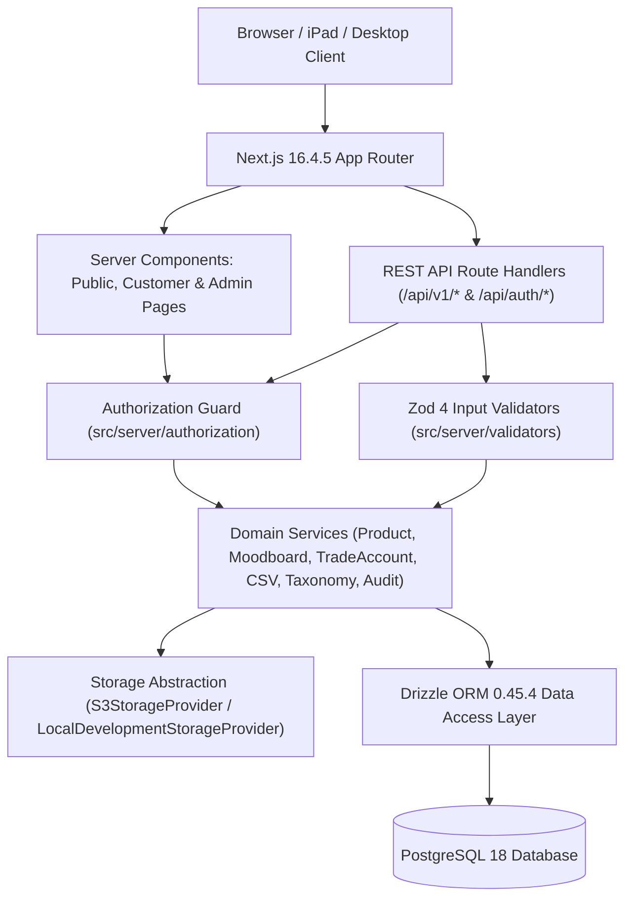

# System Architecture — MaterialHub

**Architecture Style:** Modular Monolith (Next.js App Router + Service Layer + Drizzle DAL + PostgreSQL)

---

## 1. High-Level Architecture Diagram

---

## 2. Layered Responsibilities

| Layer | Location | Responsibility |
|---|---|---|
| Presentation Layer | `src/app/`, `src/components/` | Editorial UI rendering, URL state synchronization, accessible forms, responsive desktop/iPad/mobile layouts. |
| API & Route Layer | `src/app/api/v1/` | HTTP request parsing, rate limiting, standardized JSON envelope formatting (`{ success, data, meta }` / `{ success, error }`). |
| Authorization Layer | `src/server/authorization/index.ts` | Centralized server-side session resolution via Better Auth, role checks (`MEMBER` vs `ADMIN`), trade status checks (`APPROVED`), and moodboard ownership verification. |
| Validation Layer | `src/server/validators/index.ts` | Strict Zod 4 schemas for products, SKUs, slugs, pagination parameters, moodboards, trade account transitions, and CSV rows. |
| Service Layer | `src/server/services/*.service.ts` | Transactional business workflows, duplicate SKU/slug detection, CSV batch atomicity, and automatic audit log generation. |
| Storage Layer | `src/lib/storage/index.ts` | `StorageProvider` interface decoupling product image uploads from the underlying storage engine (`S3StorageProvider` vs `LocalDevelopmentStorageProvider`). |
| Data Access & Persistence | `src/db/schema/index.ts`, `src/db/index.ts` | Strongly typed PostgreSQL schema, foreign keys, composite unique indexes, and connection pooling. |
