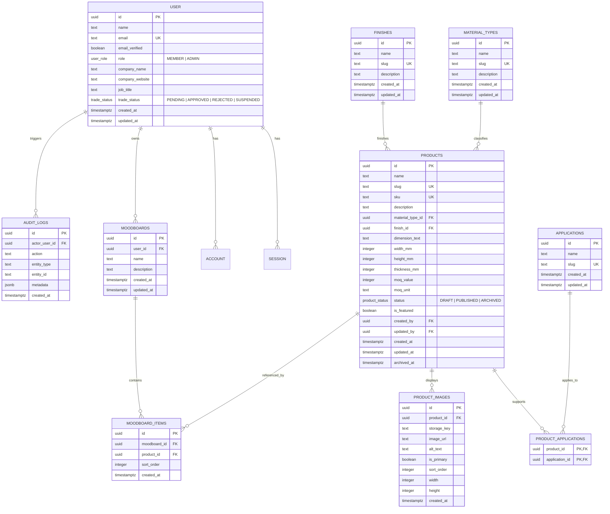

# Database Schema & Entity-Relationship Documentation

**Database Engine:** PostgreSQL 18  
**ORM & Migration Tooling:** Drizzle ORM `0.45.4` & Drizzle Kit `0.31.11`  
**Schema Source:** `src/db/schema/index.ts`  
**Committed Migrations:** `src/db/migrations/0000_reflective_darkhawk.sql`

---

## 1. Entity-Relationship Diagram (ERD)

---

## 2. Key Relational Constraints & Indexes

1. **Primary Keys:** All application and authentication entities use PostgreSQL native `uuid` (`pg_catalog.gen_random_uuid()`).
2. **Product Uniqueness:** `products.sku` (`products_sku_idx`) and `products.slug` (`products_slug_idx`) enforce database-level uniqueness.
3. **Moodboard Deduplication:** `moodboard_items` enforces a composite unique index `moodboard_items_unique_product_idx` on `(moodboard_id, product_id)`, guaranteeing that the same product cannot be added twice to the same moodboard.
4. **Archived Product Integrity:** `moodboard_items.product_id` uses `ON DELETE RESTRICT`, while products are archived via `status = 'ARCHIVED'` and `archived_at` timestamp rather than hard-deleted, preserving historical moodboard references.
